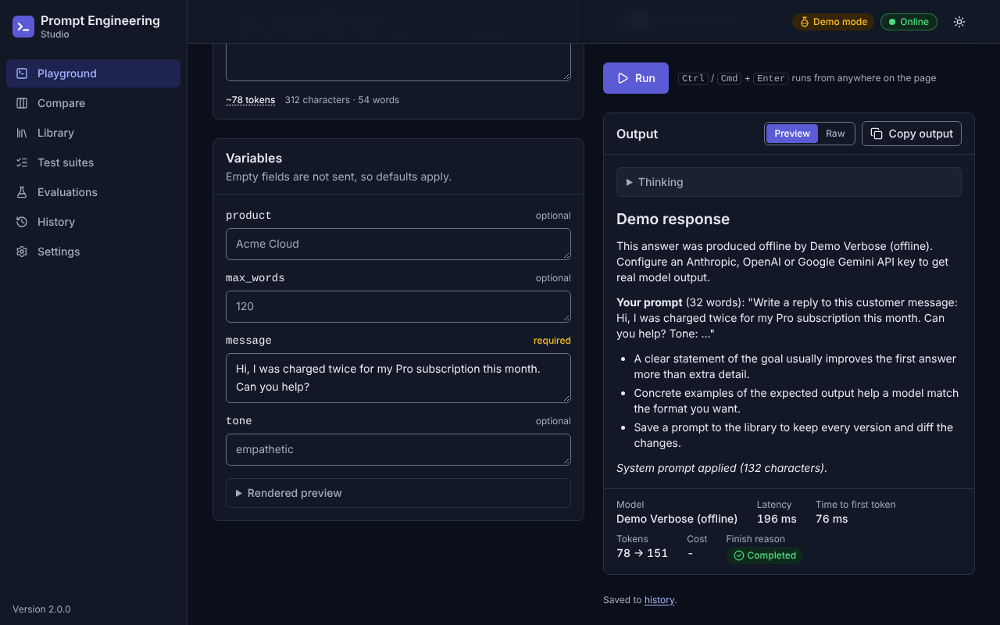
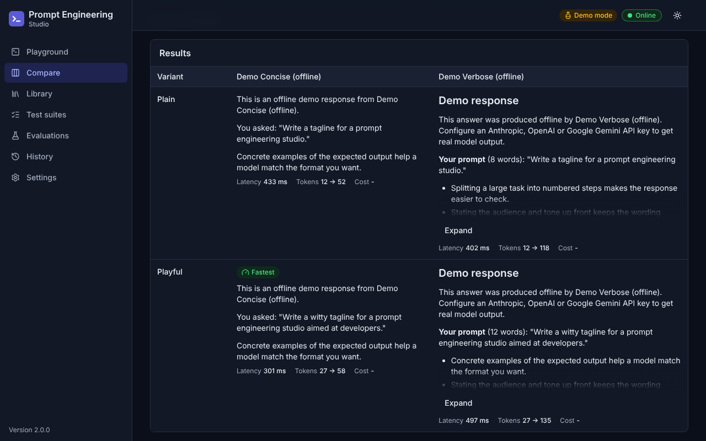
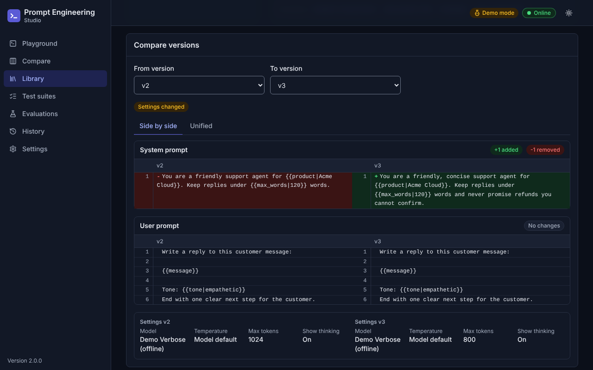
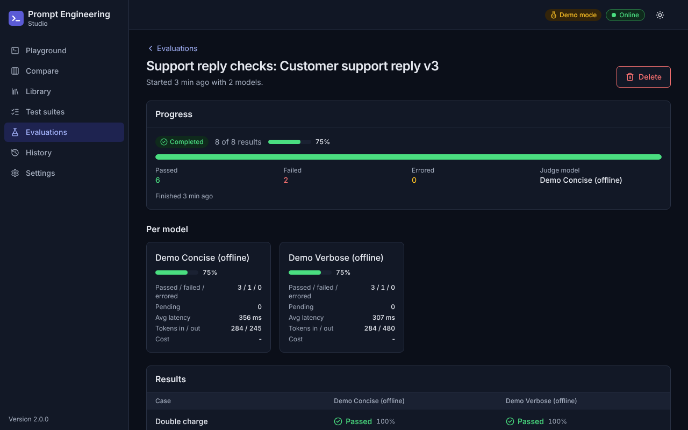
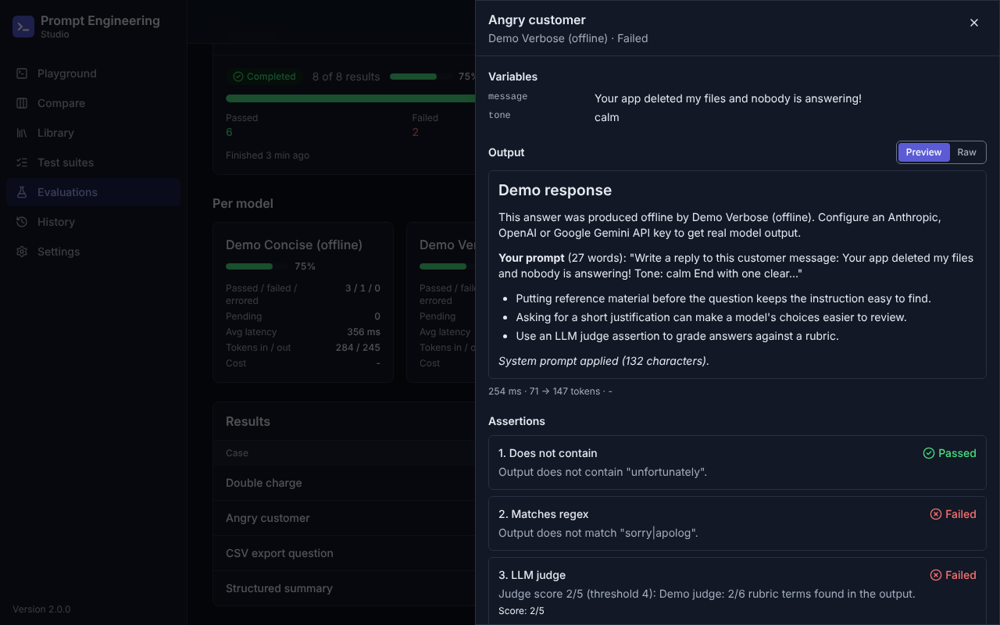
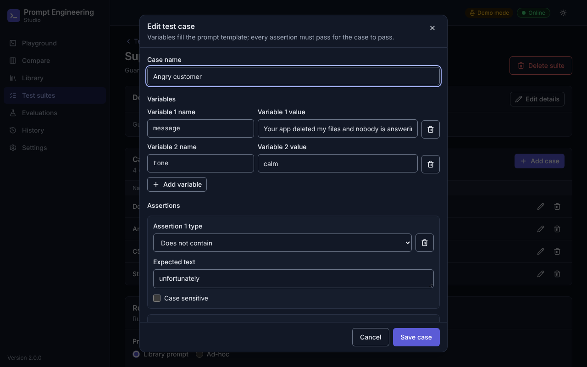
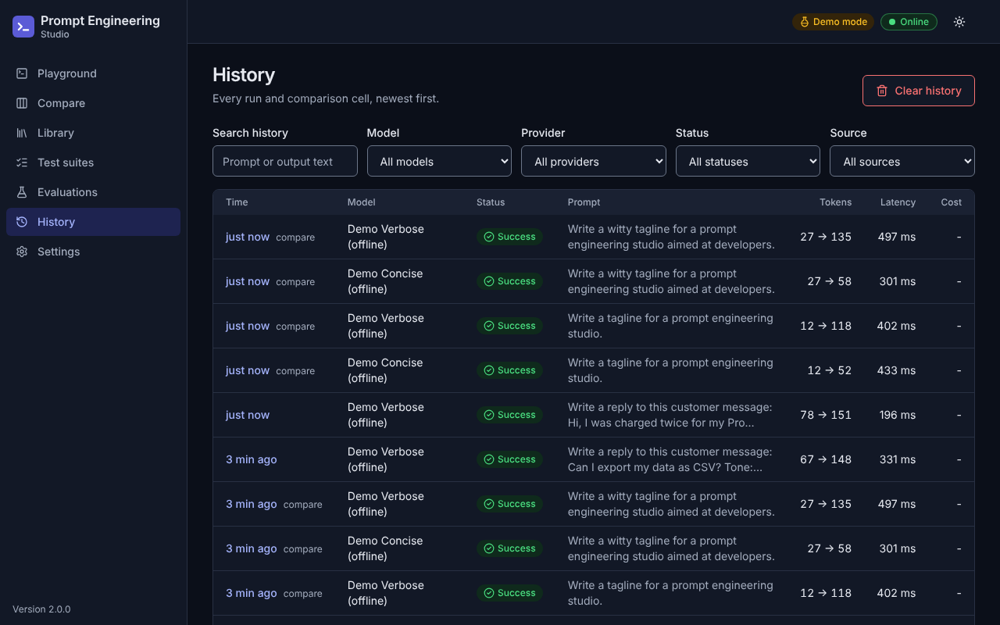
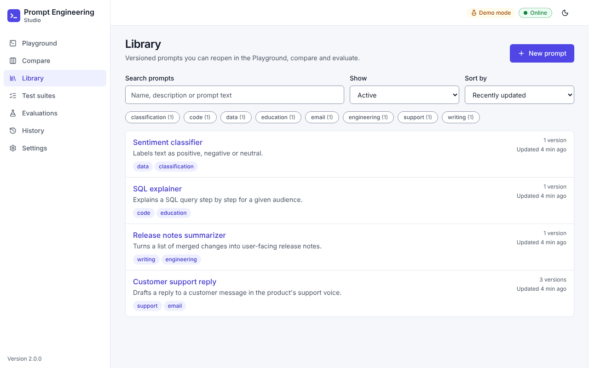
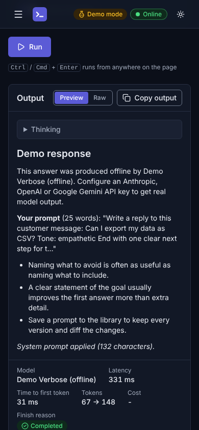
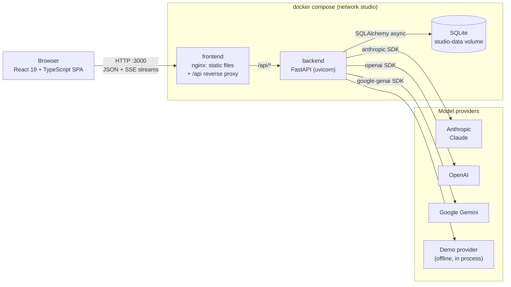

# Prompt Engineering Studio

[](https://github.com/Mayank-thakur21/octo-train-prompt/actions/workflows/ci.yml)


[](LICENSE)

A self-hosted workbench for writing, running, versioning, comparing and testing LLM prompts.
Claude (Anthropic) is the default provider, OpenAI and Google Gemini are optional, and an offline
demo provider keeps everything usable without any API key.



## Contents

- [Features](#features)
- [Feature tour](#feature-tour)
- [Architecture](#architecture)
- [Quick start](#quick-start)
- [Configuration](#configuration)
- [Providers and models](#providers-and-models)
- [Template syntax](#template-syntax)
- [Assertion types](#assertion-types)
- [API reference](#api-reference)
- [Security](#security)
- [Testing and quality gates](#testing-and-quality-gates)
- [Project structure](#project-structure)
- [License](#license)

## Features

- **Playground**: system and user prompts with `{{variables}}`, a form generated from the template,
  streamed output (Markdown or raw), a Stop button, an optional thinking summary, live token
  estimates and per-run metrics (latency, time to first token, tokens, cost, finish reason).
- **Multiple providers**: Anthropic Claude models out of the box, plus OpenAI and Google Gemini
  models when their keys are set. An offline demo provider answers deterministically when no key is
  configured.
- **Prompt library**: named prompts with tags, search, archiving and immutable versions. Versions
  can be compared side by side or as a unified diff and restored.
- **Compare**: up to 4 prompt variants against up to 4 models in one streamed grid, with the
  fastest and cheapest cells highlighted. A failing cell never fails the whole comparison.
- **Test suites and evaluations**: cases with variables and assertions (text, regex, length, JSON,
  JSON schema, LLM judge) run in the background across several models, with live progress, pass
  rates per model and a result matrix.
- **History**: every run and comparison cell with filters, full detail and one-click re-run.
- **Import and export**: prompts, suites and optionally history as one JSON document, with skip,
  rename or overwrite conflict handling and conversion of legacy `{placeholder}` prompts.
- **Production basics**: optional API-key auth, per-group rate limits, body size limits, strict
  security headers and CSP, structured logs with secret redaction, health checks, Docker images
  running as non-root users, and CI on every push.
- **Accessible, responsive UI**: keyboard operable, screen-reader labels, dark and light themes,
  usable down to 360 px wide.

## Feature tour

| | |
|---|---|
|  |  |
| **Compare**: variants x models, streamed cell by cell, with Fastest and Cheapest badges. | **Library**: every save is a new immutable version; diff and restore any of them. |
|  |  |
| **Evaluations**: background runs with progress, per-model summaries and a result matrix. | **Result detail**: output, variables and every assertion with its detail and score. |
|  |  |
| **Test suites**: cases with variables and typed assertion editors. | **History**: filter by text, model, provider, status and source; open, re-run or delete. |
|  |  |
| **Light theme**: Dark, Light or System, remembered per browser. | **Mobile**: the same features on a 390 px wide screen. |

The screenshots were taken in demo mode, so the answers come from the offline demo provider.

## Architecture



- **Frontend** (`frontend/`): React 19, React Router, TanStack Query and Tailwind CSS v4, built
  with Vite. All API calls go through one typed client; streams are read with an SSE-over-`fetch`
  parser so a run can be stopped with an `AbortController`. In production nginx serves the build
  and proxies `/api` to the backend with buffering off, so tokens reach the browser as they arrive.
- **Backend** (`backend/app/`): FastAPI with Pydantic v2 schemas and SQLAlchemy 2 (async) on
  SQLite. Routers stay thin; services hold the logic (template rendering, the run and compare
  orchestration, evaluations, diffs, import and export). Each provider SDK is imported by exactly
  one module behind a common `Provider` interface, and a registry builds the model catalog from the
  settings. Evaluations run as background tasks and survive client disconnects; runs left
  unfinished by a restart are marked as interrupted at startup.
- **Streaming**: `POST /api/runs/stream` and `POST /api/compare/stream` answer with Server-Sent
  Events (`start`, `delta` or `cell`, then `done` or `error`). Closing a run stream (the Stop
  button) cancels the provider call and saves the run to history as cancelled with its partial
  output; closing a comparison stream cancels the cells that have not finished.

## Quick start

### Docker (recommended)

Requires Docker with Compose v2.24 or newer.

```bash
git clone https://github.com/Mayank-thakur21/octo-train-prompt.git
cd octo-train-prompt
cp .env.example .env        # optional: add provider keys and API_KEYS
docker compose up --build -d
```

- UI: <http://localhost:3000>
- API docs (Swagger UI): <http://localhost:3000/api/docs>

Only the frontend container publishes a port. The SQLite database lives in the `studio-data`
volume, so `docker compose down` keeps your data (`docker compose down -v` deletes it). Both
containers run as non-root users with read-only root filesystems.

### Local development

Requires Python 3.12 or 3.13, Node.js 22 and `make`.

```bash
make install        # backend/.venv with the dev requirements, then npm ci
make dev            # API on :8000 with reload + Vite on :5173 (or use dev-backend / dev-frontend)
```

Open <http://localhost:5173>. The Vite dev server proxies `/api` to `http://localhost:8000`
(set `API_PROXY_TARGET` to use another backend address). `make dev-backend` loads the repository
root `.env` when it exists; the default database is `backend/data/studio.db`.

| Make target | What it does |
|---|---|
| `make install` | Create `backend/.venv` with `requirements-dev.txt` and run `npm ci` in `frontend/` |
| `make dev` | Run `dev-backend` and `dev-frontend` together |
| `make dev-backend` | `uvicorn app.main:create_app --factory --reload --port 8000` |
| `make dev-frontend` | `npm run dev` (Vite on port 5173) |
| `make lint` | `ruff check`, `ruff format --check`, `npm run lint`, `npm run typecheck` |
| `make format` | `ruff format` and `ruff check --fix` |
| `make test` | `pytest -W error` (with the coverage gate) and `npm test` |
| `make build` | Production build of the frontend into `frontend/dist` |
| `make docker-build` | Build both images |
| `make up` / `make down` | Start the Compose stack in the background / stop it |
| `make clean` | Remove the virtual environment, `node_modules`, build output and caches |

### Demo mode

Without any provider key the app starts in demo mode: the catalog still lists every model, but
only the two offline demo models are available and one of them becomes the default. Demo answers
are deterministic (the same prompt always gives the same text) and the prompt may contain
directives to exercise the UI:

| Directive | Effect |
|---|---|
| `[[demo:echo]]` | Answer with the prompt itself |
| `[[demo:json]]` | Answer with a small JSON object (`echo`, `model`, `words`) |
| `[[demo:refuse]]` | Empty answer with finish reason `refusal` |
| `[[demo:delay=3000]]` | Wait the given milliseconds (0 to 10000) before answering, useful to try Stop |
| `[[demo:error=rate_limited]]` | Fail with a provider error: `auth`, `rate_limited`, `overloaded`, `invalid_request`, `timeout` or `provider_error` |

When an LLM-judge assertion runs on a demo model, the demo judge scores the output by how many
rubric words it contains.

## Configuration

All settings are environment variables (case-insensitive), read once at startup; an invalid value
stops the backend with a message naming the setting. Copy [`.env.example`](.env.example), which
lists every variable below with its default. Comma lists accept spaces around items. Rate limits
use the [limits](https://limits.readthedocs.io/) syntax and several can be joined with `;`
(for example `30/minute;500/day`).

**Model providers**

| Variable | Default | Description |
|---|---|---|
| `ANTHROPIC_API_KEY` | empty | Enables the Anthropic provider (Claude models). |
| `OPENAI_API_KEY` | empty | Enables the OpenAI provider. |
| `OPENAI_BASE_URL` | empty | Optional OpenAI-compatible endpoint (Chat Completions with `max_completion_tokens`). Empty = the OpenAI API. |
| `GEMINI_API_KEY` | empty | Enables the Google Gemini provider. |
| `OPENAI_MODELS` | `gpt-5.5,gpt-5.4-mini,gpt-4.1-mini` | OpenAI catalog entries, each `id` or `id=Display Name`. |
| `GEMINI_MODELS` | `gemini-3.5-flash,gemini-3.1-pro-preview` | Gemini catalog entries, same syntax. |
| `OPENAI_TEMPERATURE_PREFIXES` | `gpt-4,gpt-3.5,chatgpt-4o` | OpenAI id prefixes that accept `temperature`. |
| `OPENAI_MAX_OUTPUT_TOKENS` | `32768` | Output token limit assumed for every OpenAI entry. |
| `GEMINI_MAX_OUTPUT_TOKENS` | `65536` | Output token limit assumed for every Gemini entry. |
| `DEMO_ENABLED` | `true` | List the offline demo models `demo-concise` and `demo-verbose`. |
| `DEMO_STREAM_DELAY_MS` | `20` | Delay between streamed demo chunks in milliseconds (0 to 1000). |
| `DEFAULT_MODEL` | `claude-opus-5-5` | Preferred default model. Must be a catalog id: `claude-opus-5-5`, `claude-sonnet-5-5`, `claude-haiku-5-5`, `claude-fable-5-1`, an `OPENAI_MODELS` or `GEMINI_MODELS` id, `demo-concise` or `demo-verbose`. When its provider has no key the first available model is used. |
| `JUDGE_MODEL` | empty | Default model for LLM-judge assertions (a catalog id). Empty = the effective default model. |
| `JUDGE_MAX_TOKENS` | `2048` | `max_tokens` for judge calls (capped by the judge model's limit). |

**Storage**

| Variable | Default | Description |
|---|---|---|
| `DATABASE_URL` | `sqlite+aiosqlite:///./data/studio.db` | SQLAlchemy async database URL. Compose uses `sqlite+aiosqlite:////app/data/studio.db` on the `studio-data` volume. |

**Security**

| Variable | Default | Description |
|---|---|---|
| `API_KEYS` | empty | Accepted `X-API-Key` values, each at least 16 characters. **Empty = open API.** |
| `CORS_ORIGINS` | `http://localhost:5173,http://localhost:3000` | Browser origins allowed to call the API directly (`*` only when set explicitly). |
| `TRUSTED_PROXIES` | empty | IPs or CIDRs allowed to set `X-Forwarded-For`. Compose sets `172.28.0.10` (the nginx container). |
| `RATE_LIMIT_ENABLED` | `true` | Master switch for rate limiting. |
| `RATE_LIMIT_STORAGE_URI` | `memory://` | Storage for rate-limit counters (`async+` is added automatically). `redis://` URIs need a Redis client package installed. |
| `RATE_LIMIT_DEFAULT` | `300/minute` | Default group (most endpoints, including `/api/meta`). |
| `RATE_LIMIT_RUNS` | `30/minute` | `POST /api/runs` and `/api/runs/stream`. |
| `RATE_LIMIT_COMPARE` | `10/minute` | `POST /api/compare` and `/api/compare/stream`. |
| `RATE_LIMIT_EVALS` | `10/minute` | `POST /api/evals`. |
| `RATE_LIMIT_TOKENS` | `120/minute` | Token estimates and template rendering. |
| `RATE_LIMIT_DATA` | `10/minute` | Export and import. |
| `RATE_LIMIT_AUTH_FAILURES` | `10/minute` | Failed API-key attempts per client IP. |
| `MAX_BODY_BYTES` | `2097152` | Request body limit in bytes (2 MiB). |
| `IMPORT_MAX_BYTES` | `5242880` | Body limit for `POST /api/import` in bytes (5 MiB). |

**Request limits**

| Variable | Default | Description |
|---|---|---|
| `MAX_PROMPT_CHARS` | `100000` | Maximum user prompt template length. |
| `MAX_SYSTEM_CHARS` | `50000` | Maximum system prompt template length. |
| `MAX_RENDERED_CHARS` | `200000` | Maximum rendered system + user prompt length. |
| `MAX_VARIABLES` | `50` | Variables per request or test case. |
| `MAX_VARIABLE_VALUE_CHARS` | `50000` | Maximum length of one variable value. |
| `MAX_OUTPUT_TOKENS` | `16384` | Global cap on `max_tokens` (and on each model's output limit). |
| `DEFAULT_MAX_TOKENS` | `4096` | `max_tokens` used when a request leaves it empty. |
| `MAX_COMPARE_VARIANTS` | `4` | Prompt variants per comparison. |
| `MAX_COMPARE_MODELS` | `4` | Models per comparison. |
| `MAX_COMPARE_CELLS` | `12` | Variants x models per comparison. |
| `COMPARE_CONCURRENCY` | `4` | Comparison cells running at the same time. |
| `COMPARE_TOTAL_TIMEOUT_SECONDS` | `180` | Overall deadline for one comparison; unfinished cells become timeouts. |
| `MAX_CASES_PER_SUITE` | `100` | Test cases per suite. |
| `MAX_ASSERTIONS_PER_CASE` | `20` | Assertions per test case. |
| `MAX_EVAL_MODELS` | `4` | Models per evaluation. |
| `MAX_EVAL_CALLS` | `200` | Provider calls per evaluation: cases x models, plus one judge call per LLM judge assertion and model. |
| `EVAL_CONCURRENCY` | `4` | Evaluation calls running at the same time per evaluation. |
| `MAX_TAGS_PER_PROMPT` | `10` | Tags per prompt. |
| `MAX_VERSIONS_PER_PROMPT` | `200` | Versions per prompt. |
| `HISTORY_MAX_ROWS` | `5000` | History retention: older entries beyond this count are deleted. |

**Provider calls**

| Variable | Default | Description |
|---|---|---|
| `REQUEST_TIMEOUT_SECONDS` | `120` | Deadline for one provider call or stream, in seconds (1 to 600). |
| `PROVIDER_MAX_RETRIES` | `2` | Retries done by the provider SDKs before output starts (0 to 5). |
| `PROVIDER_CONCURRENCY` | `16` | Provider calls running at the same time across the server. |
| `SSE_KEEPALIVE_SECONDS` | `15` | Interval of keepalive comments on idle streams, in seconds. |

**Server**

| Variable | Default | Description |
|---|---|---|
| `DOCS_ENABLED` | `true` | Serve Swagger UI at `/api/docs` and the schema at `/api/openapi.json`. |
| `LOG_LEVEL` | `INFO` | `DEBUG`, `INFO`, `WARNING` or `ERROR`. |
| `LOG_FORMAT` | `text` | `text` or `json` (Compose sets `json`). |

## Providers and models

`GET /api/models` returns the catalog in this order: Anthropic, OpenAI (in `OPENAI_MODELS`
order), Gemini (in `GEMINI_MODELS` order), then the demo models. A model is available when its
provider has a key; unavailable models stay visible in the pickers with the suffix "(no API key)".
The effective default is `DEFAULT_MODEL` when available, otherwise the first available model.

| Provider | Key | Models | Notes |
|---|---|---|---|
| Anthropic | `ANTHROPIC_API_KEY` | Claude Opus 5.5 (default), Claude Sonnet 5.5, Claude Haiku 5.5, Claude Fable 5.1 | 1M-token context, up to 128K output tokens (capped by `MAX_OUTPUT_TOKENS`). Exact token counts for estimates. Cost is computed from the built-in price list. |
| OpenAI | `OPENAI_API_KEY` | `OPENAI_MODELS` | Chat Completions streaming. `OPENAI_BASE_URL` points it at a compatible server. |
| Google Gemini | `GEMINI_API_KEY` | `GEMINI_MODELS` | Uses the current `google-genai` SDK. |
| Demo | none | Demo Concise, Demo Verbose | Offline and deterministic, listed while `DEMO_ENABLED=true`. |

**Thinking toggle.** "Show thinking" asks the model to reason before answering and streams a
summary of that reasoning into a collapsible section.

- On Claude models it enables adaptive thinking with summarized output. Claude Opus 5.5 and Claude
  Fable 5.1 always think; for them the switch only controls whether the summary is shown. Claude
  Sonnet 5.5 and Claude Haiku 5.5 run with thinking off when the switch is off.
- Gemini models (except the 1.x and 2.0 families) include their thought summaries when it is on.
- OpenAI models do not support the switch; it is disabled in the UI and ignored with a warning by
  the API.

**Temperature.** Claude models choose their own sampling, so temperature is not sent (the UI
disables the slider and the API ignores it with a warning). OpenAI models accept it only when the
id starts with one of `OPENAI_TEMPERATURE_PREFIXES`; Gemini and demo models accept it. "Use model
default" (the default) sends no temperature at all.

**Retries and timeouts.** The SDKs retry connection errors and overload responses up to
`PROVIDER_MAX_RETRIES` times before the first token; nothing is retried once output has started.
Every call is bounded by `REQUEST_TIMEOUT_SECONDS`, and at most `PROVIDER_CONCURRENCY` calls run at
once across the server.

## Template syntax

Prompts and system prompts are templates. The same grammar is implemented by the backend (which
renders) and the frontend (which builds the variables form).

| Syntax | Meaning |
|---|---|
| `{{name}}` or `{{ name }}` | Required variable. Names start with a letter or `_`, then letters, digits or `_` (max 64), case-sensitive. |
| `{{name\|default text}}` | Variable with a default. The default ends at the first `}}`, may contain `\|` and single braces, but not a newline. Surrounding spaces are trimmed. |
| `\{{` | A literal `{{` (so `\{{name}}` renders as `{{name}}`). |
| anything else | Literal text: single braces such as `{"a": 1}`, `{{ not valid }}`, `{{1abc}}`. |

Rendering rules:

- A value you provide always wins, even an empty string. Otherwise the placeholder's own default is
  used, then the first default declared for that name anywhere in the system or user prompt.
- Values are inserted as-is and never re-rendered, so a value containing `{{x}}` stays literal.
- A variable with no value and no default stops the run with `422 missing_variables`. The
  Playground does not send empty fields, so defaults apply. In Compare, a variable is marked
  required when any variant that uses it has no default of its own.
- Both halves scan templates in linear time, so a 100,000-character prompt renders in
  milliseconds even when it is full of unterminated `{{name|` placeholders.

```text
System: You are a {{persona|helpful}} assistant.
Prompt: Explain {{topic}} to a {{audience|beginner}} audience in {{count|3}} bullet points.
```

With `topic = "photosynthesis"` this renders `Explain photosynthesis to a beginner audience in 3
bullet points.` Ten built-in templates (Summarizer, Code Reviewer, Email Writer, Idea Generator,
Explainer, Translator, Bug Fixer, Blog Writer, Structured Extractor, Sentiment Classifier) are
available from the Templates button. Prompts written for the old `{name}` syntax can be converted
on import with "Convert legacy {placeholders}".

## Assertion types

A test case passes when every assertion passes. Each assertion is checked against the model's
final text.

| Type | Fields (defaults) | Passes when |
|---|---|---|
| `contains` | `value`, `case_sensitive` (false) | The output contains `value` |
| `not_contains` | `value`, `case_sensitive` (false) | The output does not contain `value` |
| `equals` | `value`, `case_sensitive` (true), `trim` (true) | The output equals `value` |
| `starts_with` | `value`, `case_sensitive` (true), `trim` (true) | The output starts with `value` |
| `regex` | `pattern`, `flags` (any of `i`, `m`, `s`) | The pattern matches anywhere (Python `regex` syntax, 1 s timeout) |
| `max_chars` | `value` | The output has at most `value` characters |
| `min_chars` | `value` | The output has at least `value` characters |
| `json_valid` | none | The output parses as JSON (a surrounding Markdown code fence is ignored) |
| `json_schema` | `schema` | The output is valid JSON and matches the schema |
| `llm_judge` | `rubric`, `threshold` (4), `judge_model` (server default) | A judge model scores the output 1 to 5 against the rubric and the score is at least `threshold` |

`json_schema` supports `type`, `properties`, `required`, `additionalProperties` (boolean),
`items`, `minItems`, `maxItems`, `enum`, `const`, `minLength`, `maxLength`, `pattern`,
`minimum`, `maximum`, `exclusiveMinimum` and `exclusiveMaximum`; any other keyword is rejected
when the case is saved. Regex patterns are also compiled when the case is saved. The judge model is
the assertion's `judge_model`, else the evaluation's judge model, else `JUDGE_MODEL`, else the
default model.

## API reference

Interactive documentation is served at `/api/docs` (and the schema at `/api/openapi.json`) while
`DOCS_ENABLED=true`. Every error uses one envelope:

```json
{"error": {"code": "missing_variables", "message": "Some template variables have no value: topic.", "details": {"missing": ["topic"]}}}
```

Every response carries an `X-Request-ID` header, and `429` responses carry `Retry-After`.

| Method | Path | Description |
|---|---|---|
| GET | `/api/health` | Liveness: status, version and server time (no auth, no rate limit) |
| GET | `/api/ready` | Readiness: database check (no auth, no rate limit) |
| GET | `/api/meta` | App name and version, auth and demo mode, providers, limits (no auth) |
| GET | `/api/models` | Model catalog with availability, capabilities and pricing |
| POST | `/api/runs` | Run a prompt and wait for the full result |
| POST | `/api/runs/stream` | Run a prompt as a stream: `start`, `delta`..., then `done` or `error` |
| POST | `/api/tokens/estimate` | Token estimate for a prompt (exact for Claude models when a key is set) |
| GET | `/api/templates` | Built-in templates |
| POST | `/api/templates/render` | Render a template (strict or lenient) and list its variables |
| GET | `/api/prompts` | List prompts: `q`, `tag` (repeatable), `archived`, `sort`, `order`, `limit`, `offset` |
| POST | `/api/prompts` | Create a prompt with its first version |
| GET | `/api/prompts/{prompt_id}` | Prompt with its latest version |
| PATCH | `/api/prompts/{prompt_id}` | Rename, describe, tag, archive or unarchive |
| DELETE | `/api/prompts/{prompt_id}` | Delete a prompt and its versions |
| GET | `/api/prompts/{prompt_id}/versions` | Versions, newest first |
| POST | `/api/prompts/{prompt_id}/versions` | Add a version (`409 no_changes` when identical to the latest) |
| GET | `/api/prompts/{prompt_id}/versions/{version}` | One version by number |
| POST | `/api/prompts/{prompt_id}/versions/{version}/restore` | Copy an old version into a new latest version |
| GET | `/api/prompts/{prompt_id}/diff` | Diff two versions: `from_version`, `to_version` |
| GET | `/api/prompt-versions/{version_id}` | One version by id |
| GET | `/api/tags` | Tags with usage counts |
| POST | `/api/compare` | Run variants x models and wait for the grid |
| POST | `/api/compare/stream` | Same as a stream: `start`, one `cell` per finished cell, `done` |
| GET | `/api/suites` | List test suites: `q`, `limit`, `offset` |
| POST | `/api/suites` | Create a suite (optionally with cases) |
| GET | `/api/suites/{suite_id}` | Suite with its cases |
| PATCH | `/api/suites/{suite_id}` | Rename or describe a suite |
| DELETE | `/api/suites/{suite_id}` | Delete a suite and its cases |
| POST | `/api/suites/{suite_id}/cases` | Add a case |
| PUT | `/api/suites/{suite_id}/cases/{case_id}` | Replace a case |
| DELETE | `/api/suites/{suite_id}/cases/{case_id}` | Delete a case |
| POST | `/api/evals` | Start an evaluation (`202`, runs in the background) |
| GET | `/api/evals` | List evaluations: `suite_id`, `prompt_id`, `status`, `limit`, `offset` |
| GET | `/api/evals/{eval_id}` | Evaluation with progress, per-model summary and results |
| POST | `/api/evals/{eval_id}/cancel` | Cancel a queued or running evaluation |
| DELETE | `/api/evals/{eval_id}` | Delete an evaluation (cancels it first if needed) |
| GET | `/api/history` | List history: `q`, `model`, `provider`, `status`, `source`, `group_id`, `limit`, `offset` |
| GET | `/api/history/{history_id}` | One history entry with templates, variables, output and metrics |
| DELETE | `/api/history/{history_id}` | Delete one entry |
| DELETE | `/api/history` | Delete all history |
| GET | `/api/export` | Download prompts, suites and optionally history: `include=prompts,suites,history` |
| POST | `/api/import` | Import an export document: `conflict=skip\|rename\|overwrite`, `legacy_placeholders` |

## Security

- **Open by default.** With `API_KEYS` empty the API accepts every request. That is fine on your
  own machine, but anyone who can reach the server can then spend your provider credits; the
  backend logs a warning at startup when provider keys are set and `API_KEYS` is empty. Set
  `API_KEYS` (one or more keys of at least 16 characters) before exposing the app.
- **API keys.** Clients send `X-API-Key`. Keys are compared in constant time against every
  configured key, never logged and never returned. Repeated failures from one IP are limited by
  `RATE_LIMIT_AUTH_FAILURES`. The key is checked before the request body is read, so a request
  without a valid key always gets `401`, even with a malformed body. `/api/health`, `/api/ready`,
  `/api/meta` and the API docs stay public. In the UI the key is entered under Settings and kept
  in that browser's `localStorage`.
- **Rate limits.** Requests are counted per API key (or per client IP without one; IPv6 clients by
  their /64 network) in the groups default, runs, compare, evals, tokens and data. A refused request
  gets `429 rate_limited` with `Retry-After`. The default `memory://` storage is per process.
- **Proxies.** `X-Forwarded-For` is only trusted from addresses in `TRUSTED_PROXIES`. Compose pins
  the nginx container to `172.28.0.10` and trusts only that address.
- **Request hygiene.** Bodies are limited to `MAX_BODY_BYTES` (`IMPORT_MAX_BYTES` for imports),
  every request model rejects unknown fields, and all lengths and counts are capped (see the
  configuration table). Integers in paths, queries and imports are bounded (at most 2^31 - 1), and
  imported numbers such as `NaN` or negative token counts are rejected.
- **Bounded CPU work.** Every request does work proportional to its size: template scanning and
  the demo directives are linear, version diffs use Myers' algorithm with a fixed work budget (past
  it, the changed middle is shown as removed and added) and run off the event loop, every regex in
  one assertion shares a single 1 s budget, and LLM judge calls count against `MAX_EVAL_CALLS`.
- **Headers.** The API sends `nosniff`, `X-Frame-Options: DENY`, `Referrer-Policy: no-referrer`,
  cross-origin isolation headers and `Content-Security-Policy: default-src 'none'`. nginx serves the
  app with a strict CSP (`script-src 'self'`, no inline scripts or styles). Model output is rendered
  as Markdown without raw HTML, and unsafe link schemes such as `javascript:` are removed.
- **Errors and logs.** Clients only ever see the error envelope; provider error bodies, stack
  traces and SQL stay in the server logs. Logs (text or JSON) redact configured secrets and
  anything that looks like an API key.
- **What is stored.** The SQLite database holds prompts and versions, test suites, evaluation runs
  and results, and history: templates, variables, rendered prompts, outputs, thinking summaries,
  token counts and safe error messages. Provider keys and API keys are never written to it.
  History keeps the newest `HISTORY_MAX_ROWS` entries. The browser stores only the theme, the API
  key and unsent Playground and Compare drafts.

## Testing and quality gates

No test touches the network: provider SDKs are exercised through mock HTTP transports and a
fixture blocks real sockets.

```bash
# backend (from backend/)
ruff check .
ruff format --check .
python -m pytest -W error        # branch coverage gate: 90%

# frontend (from frontend/)
npm ci
npm run lint
npm run typecheck
npm test
npm run build
npm run coverage                 # optional coverage report
```

[CI](.github/workflows/ci.yml) runs the backend gates on Python 3.12 and 3.13 and the frontend gates
on Node 22 for every push and pull request to `main`, then builds both Docker images and validates
`docker-compose.yml`. Dependabot proposes monthly, grouped updates for pip, npm, GitHub Actions and
the Docker base images.

## Project structure

```text
octo-train-prompt/
├── backend/
│   ├── app/
│   │   ├── main.py              # create_app() factory, lifespan, middleware wiring
│   │   ├── config.py            # Settings (environment variables)
│   │   ├── db.py, models.py     # async SQLAlchemy engine and ORM models
│   │   ├── schemas.py           # Pydantic request and response models
│   │   ├── errors.py            # error codes and the error envelope
│   │   ├── security.py          # API-key auth, client IP, rate limiting
│   │   ├── middleware.py        # request id, access log, security headers, body limit
│   │   ├── logging_config.py    # text/JSON logging with secret redaction
│   │   ├── sse.py               # Server-Sent Events framing and keepalive
│   │   ├── providers/           # anthropic, openai, gemini, demo, catalog, registry
│   │   ├── routers/             # one module per API area
│   │   └── services/            # templating, runner, compare, evaluation, diff, export, ...
│   ├── tests/                   # pytest suite with fake providers and SDK mock transports
│   ├── Dockerfile               # multi-stage, non-root, health check
│   ├── pyproject.toml           # ruff, pytest and coverage settings
│   └── requirements*.txt        # pinned runtime and dev dependencies
├── frontend/
│   ├── src/
│   │   ├── api/                 # typed client, SSE parser, endpoints, query keys
│   │   ├── components/          # app components and ui/ primitives
│   │   ├── context/             # settings (theme, API key) and toasts
│   │   ├── hooks/               # streaming runs and comparisons, debouncing, hotkeys
│   │   ├── lib/                 # template grammar, diff pairing, formatting, storage
│   │   └── pages/               # one module per route
│   ├── nginx.conf               # SPA + /api proxy with security headers
│   ├── Dockerfile               # node build stage, unprivileged nginx runtime
│   └── vite.config.ts           # Vite, Tailwind, dev proxy and Vitest settings
├── docs/screenshots/            # README images
├── .github/                     # CI workflow and Dependabot
├── docker-compose.yml
├── .env.example
├── Makefile
└── LICENSE
```

## License

MIT © Mayank Thakur. See [LICENSE](LICENSE).
